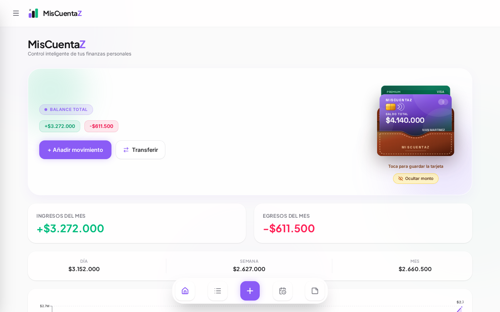
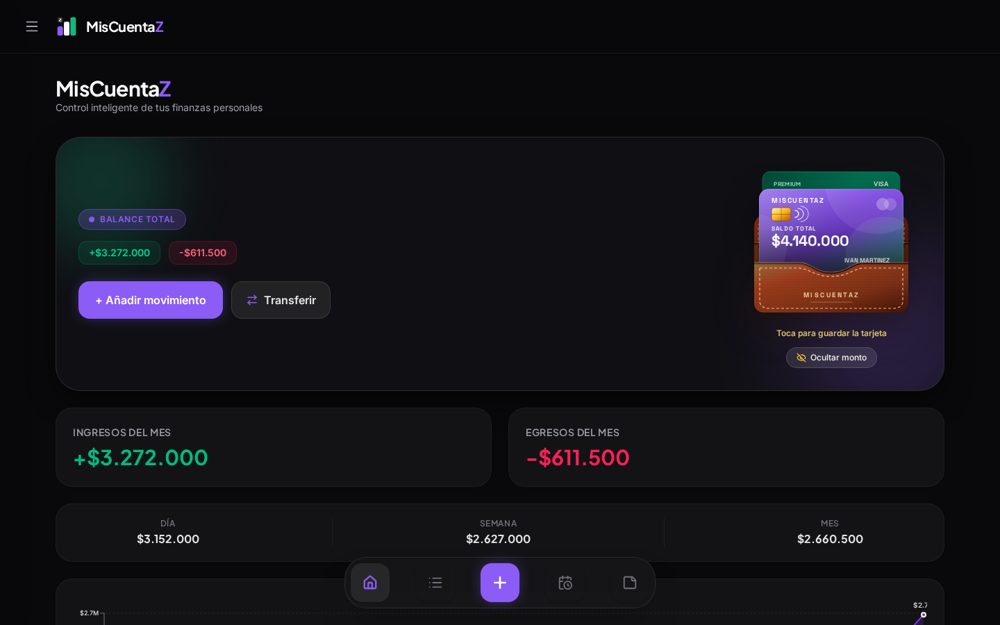
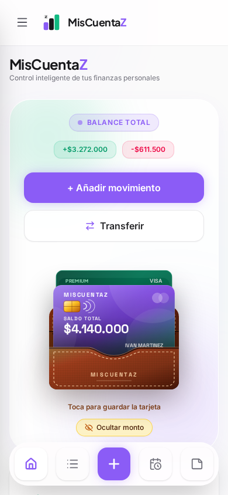
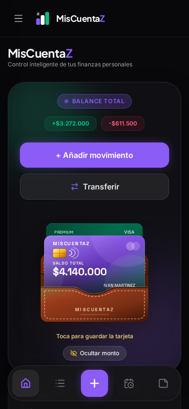
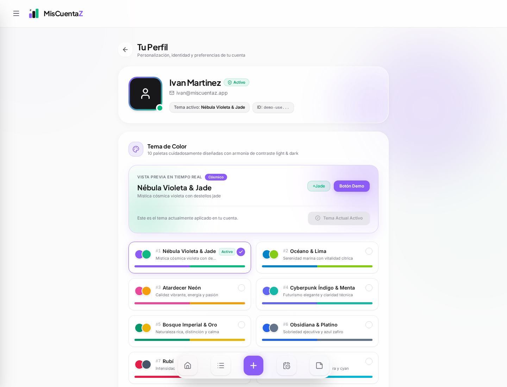
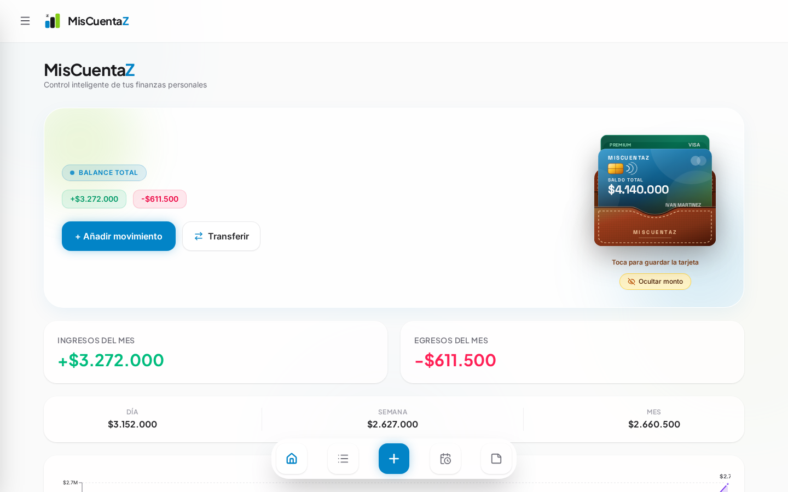
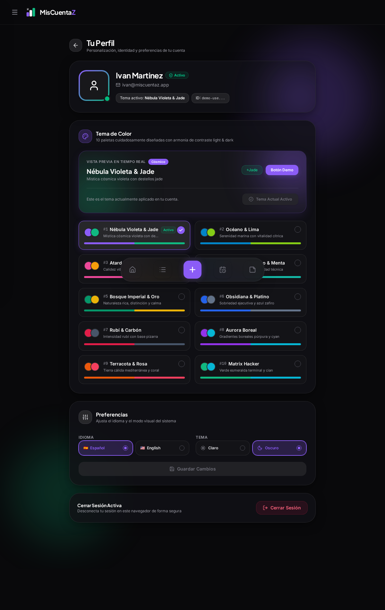
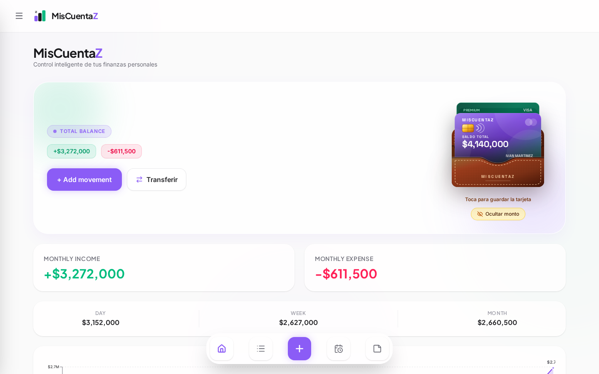
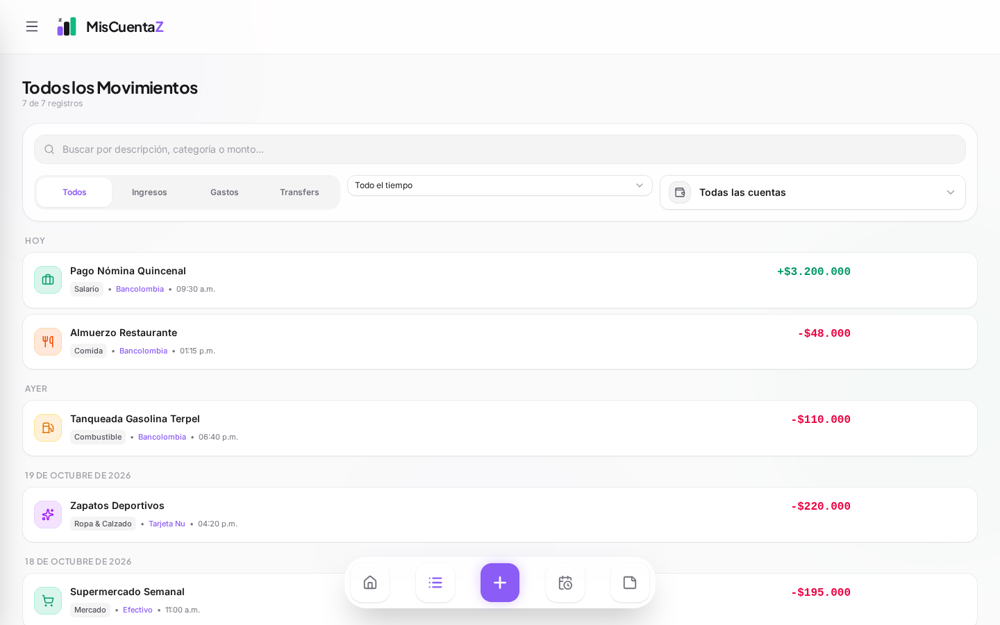

# MisCuentaZ

Plataforma de gestión financiera personal enfocada en velocidad, privacidad y diseño de interfaz de autor. Permite registrar y monitorear ingresos, egresos, transferencias, deudas, metas de ahorro, compromisos recurrentes y notas financieras en tiempo real.

Desarrollada con arquitectura reactiva, componentes vectoriales con física háptica y un sistema de diseño basado en Minimalist Glassmorphism.

**Demo en producción:** [app-contabilidad-ivnmtz.web.app](https://app-contabilidad-ivnmtz.web.app)

---

## Interfaz de Usuario

### Tablero Principal (Modo Claro & Modo Oscuro)

<p align="center">
  
</p>

<p align="center">
  
</p>

### Experiencia Móvil

<p align="center">
  
  &nbsp;
  
</p>

---

## Personalización, Temas e Idiomas

MisCuentaZ integra un motor de personalización visual con 10 paletas temáticas calibradas, selector de modo claro/oscuro y soporte bilingüe con persistencia local.

### Catálogo de 10 Paletas del Sistema y Previsualización

<p align="center">
  
</p>

- **Previsualización en tiempo real**: Permite evaluar el balance cromático, botones y acentos antes de persistir los cambios.
- **Armonía cromática**: 10 temas ajustados para máxima legibilidad tanto en fondos claros como oscuros.

### Ejemplo de Tema Aplicado (Océano & Lima)

<p align="center">
  
</p>

### Preferencias de Interfaz (Modo Oscuro e Idiomas)

<p align="center">
  
</p>

- **Modo visual**: Alternancia entre Modo Claro y Modo Oscuro con orbes lumínicos ambientales adaptativos.
- **Internacionalización**: Localización completa en Español e Inglés con conmutación dinámica sin recarga de página.
- **Exportación segura**: Descarga de movimientos en formatos estructurados (Excel / JSON).

### Interfaz en Idioma Inglés

<p align="center">
  
</p>

### Historial de Movimientos y Categorías Prioritarias

<p align="center">
  
</p>

- **Auto-detección semántica**: Inferencia inteligente de conceptos cotidianos (comida, combustible, compras, farmacia, ropa).
- **Filtros avanzados**: Búsqueda por rango de fechas, tipo de operación y cuenta bancaria.

---

## Características Principales

### Portatarjetas Ejecutivo en Cuero
- Privacidad en reposo: el saldo total y los datos sensibles permanecen resguardados dentro del compartimento interior.
- Extracción elástica: al interactuar mediante clic, toque o teclado (`Enter` / `Espacio`), la tarjeta principal se eyecta verticalmente revelando el balance disponible.
- Control de visibilidad: alternancia rápida para enmascarar cifras confidenciales.

### Categorización Financiera Inteligente
- Catálogo optimizado con priorización en gastos frecuentes: Comida, Compras, Combustible, Farmacia y Ropa.
- Inferencia semántica contextual que clasifica automáticamente conceptos cotidianos en su categoría correspondiente.

### Prevención de Duplicados y Consistencia Patrimonial
- Validación defensiva a nivel de formulario y estado para evitar entidades bancarias o métodos de pago duplicados.
- Sincronización atómica de saldos y transacciones vinculadas para transferencias entre cuentas.

### Accesibilidad y Experiencia de Uso
- Cumplimiento de estándares de accesibilidad WCAG 2.2 AA con áreas táctiles mínimas de 44x44px.
- Navegación completa por teclado con soporte para tecla Escape en modales y retroalimentación de foco visible.
- Bloqueo preventivo de envíos dobles y deshabilitación contextual en formularios incompletos.

---

## Stack Tecnológico

| Capa | Tecnología |
| :--- | :--- |
| **Frontend** | React 19, Vite, React Router |
| **Estilos** | Tailwind CSS v4, Lucide Icons |
| **Backend & Auth** | Firebase Authentication, Cloud Firestore |
| **Visualización** | Recharts |
| **Internacionalización** | i18next, react-i18next |
| **Exportación** | xlsx-js-style |
| **Calidad y Pruebas** | Oxlint, Playwright |

---

## Instalación y Ejecución Local

### Prerrequisitos
- Node.js 20 o superior
- npm 10 o superior

### Pasos de Configuración

1. Clonar el repositorio:
   ```bash
   git clone https://github.com/ivnmtz09/app-contabilidad.git
   cd app-contabilidad
   ```

2. Instalar dependencias:
   ```bash
   npm install
   ```

3. Iniciar el entorno de desarrollo:
   ```bash
   npm run dev
   ```

4. Generar compilación de producción:
   ```bash
   npm run build
   ```

5. Previsualizar la compilación:
   ```bash
   npm run preview
   ```

---

## Licencia

Distribuido bajo licencia MIT. Desarrollado por [Ivan Martinez](https://www.instagram.com/ivjmm.0109/).
